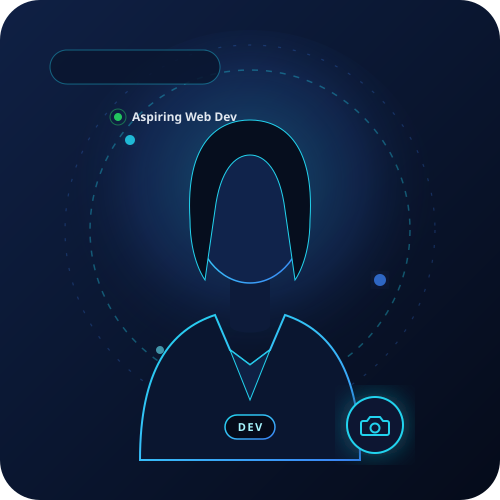

# Maria Majid - Professional Portfolio Website

A complete, modern, elegant, responsive, and professional personal portfolio website designed for **Maria Majid**, an aspiring Web Developer and Computer Science student from Rawalpindi, Pakistan.

---

## 🌟 Overview & Key Highlights

- **Candidate**: Maria Majid
- **Professional Title**: Aspiring Web Developer
- **Secondary Title**: Computer Science Student
- **Location**: Rawalpindi, Pakistan
- **Degree**: Bachelor's Degree in Computer Science, National Excellence Institute (Expected 2029)
- **Design Theme**: Professional Dual-Theme Glassmorphism System:
  - **Theme 1: Blue Cyber Glass (Dark)**: Deep navy background (`#050B1A`), secondary background (`#0A1630`), neon cyan accents (`#22D3EE`), electric blue highlights (`#3B82F6`), white typography (`#FFFFFF`), cyan glowing borders, cyber-inspired background grid, and ambient blue lighting orbs.
  - **Theme 2: Crystal Light Glass (Light)**: Crisp main background (`#F5F8FF`), secondary light blue (`#EAF2FF`), soft lavender (`#EEE9FF`), primary royal blue (`#2563EB`), high-contrast dark navy text (`#172B4D`), frosted white glass cards, and subtle blue/lavender specular shadows.
  - **Theme Switcher**: Segmented floating navbar toggle with Moon (`🌙`) & Sun (`☀️`) icons, instant reload-free transitions, `localStorage` persistence, system color scheme auto-detection (`prefers-color-scheme`), and dedicated accessible mobile drawer controls.
- **Hero Section**: Large elegant typography, professional title (*Aspiring Web Developer*), secondary title badge (*Computer Science Student*), multi-layered frosted-glass portrait frame with floating tech chips, and attractive glass buttons for **Explore Projects** and **Contact Me**.
- **Responsiveness**: 100% responsive across desktop, laptop, tablets, Android, and iPhones with zero horizontal overflow.

---

## 📁 Directory & File Structure

```text
C:\Users\User\Desktop\m portfolio\
│
├── index.html                   # Master semantic HTML5 portfolio document (with Netlify Forms)
├── netlify.toml                 # Netlify production build, security headers & caching configuration
├── _redirects                   # Netlify edge redirects & 404 routing
├── 404.html                     # Custom branded 404 error page matching dark purple theme
├── NETLIFY_DEPLOY_GUIDE.md      # Detailed step-by-step Netlify deployment & email alerts guide
├── README.md                    # Main portfolio documentation & customization guide
│
├── css\
│   └── styles.css               # Midnight dark design system, glassmorphism, responsive queries
│
├── js\
│   └── main.js                  # Navigation, scroll spy, Netlify AJAX forms, CV download, modal triggers
│
└── assets\
    ├── docs\
    │   ├── Maria_Majid_CV.pdf   # Pre-generated valid downloadable PDF CV
    │   └── Maria_Majid_CV.html  # Clean, printable HTML CV backup
    │
    └── images\
        ├── favicon.svg          # Stylized MM purple glowing vector favicon
        ├── avatar-placeholder.svg # Modern tech-themed portrait placeholder
        ├── project-hospital.svg # Custom dark-mode UI mockup for Hospital Management System
        └── project-ecommerce.svg# Custom dark-mode UI mockup for E-commerce Website
```

---

## ⚡ Quick Netlify Deployment (30 Seconds)

1. Open **[Netlify Drop](https://app.netlify.com/drop)** in your web browser.
2. Drag and drop the `m portfolio` folder directly onto the page.
3. Your website is deployed and live immediately!
4. Check **`NETLIFY_DEPLOY_GUIDE.md`** for instructions on setting your custom domain name (e.g. `maria-majid.netlify.app`) and receiving contact form notifications in your Gmail.

---

## 🚀 How to View the Portfolio

1. **Directly in Any Web Browser**:
   - Double-click `index.html` or right-click `index.html` > **Open with** > **Google Chrome** (or Edge/Firefox).
2. **With a Local Server (Optional)**:
   - In PowerShell, run:
     ```powershell
     cd "C:\Users\User\Desktop\m portfolio"
     python -m http.server 8000
     ```
   - Open your browser to `http://localhost:8000`.

---

## 🛠️ Easy Customization Guide for Maria Majid

### 1. Adding Your Real Profile Photo
1. Place your photo (e.g., `maria.jpg` or `maria.png`) into the `assets/images/` folder.
2. Open `index.html` in any text editor (such as VS Code or Notepad).
3. Search for:
   ```html
   
   ```
4. Change `assets/images/avatar-placeholder.svg` to `assets/images/maria.jpg`.

### 2. Updating Your 2-Year Teaching Experience
1. Open `index.html` and locate the `<section class="section experience-section" id="experience">` section.
2. Replace:
   - `[Institute Name – To be specified by applicant]` with your actual institute name.
   - Customize the bullet points to mention your specific classes, subjects taught, and student achievements.

### 3. Updating Project Details & Live Links
1. Open `index.html` and find the `<section class="section projects-section" id="projects">`.
2. As your project implementations progress:
   - Replace `[Technology Stack to be confirmed]` with your actual tech stack (e.g., HTML, CSS, JavaScript, Python, Django, etc.).
   - Replace the project description placeholder with your detailed scope.
   - In `js/main.js`, update the `projectData` links to point to your live GitHub repository or deployed URL.

### 4. Updating the CV File
- Whenever you export an updated resume, save it as `Maria_Majid_CV.pdf` inside `assets/docs/`.
- The **Download CV** buttons on the website will automatically deliver your newest PDF to recruiters!

### 5. Configuring Phone & WhatsApp
- Direct contact details have been protected with a recruiter verification dialogue to preserve your privacy.
- When ready to publish a direct WhatsApp link, simply update the WhatsApp button in `index.html` to:
  ```html
  <a href="https://wa.me/923XXXXXXXXX" target="_blank" rel="noopener noreferrer">...</a>
  ```

---

## 🌐 Free 1-Click Hosting Options

You can host this portfolio online for free in under 3 minutes:
1. **GitHub Pages**:
   - Push this folder to a GitHub repository named `maria-majid-portfolio`.
   - Go to **Settings > Pages** > Select `main` branch > Save.
2. **Vercel / Netlify**:
   - Drag and drop the `m portfolio` folder directly onto [Netlify Drop](https://app.netlify.com/drop) or import from GitHub on [Vercel](https://vercel.com).
